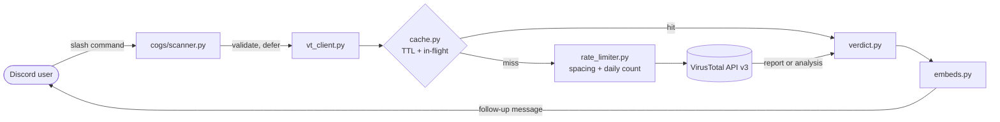
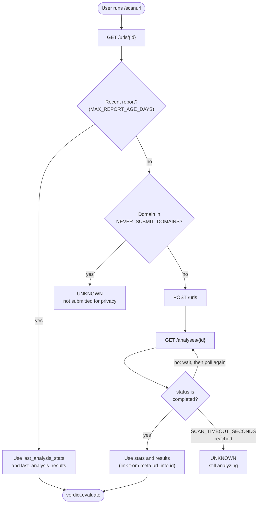

# TotalV

A Discord bot that checks URLs, file attachments, and file hashes against the
[VirusTotal v3 API](https://docs.virustotal.com/reference/overview) and returns
a verdict as a Discord embed.


## Overview

| | |
|---|---|
| Language | Python 3.11+ (tested on 3.11 and 3.13) |
| Discord | discord.py 2.7, slash commands via `app_commands` and cogs, default intents only |
| HTTP | aiohttp, with a thin custom VirusTotal client (no `vt-py`) |
| Configuration | Environment variables, optionally loaded from `.env` by python-dotenv |
| Storage | In memory only (TTL cache and request counter), no database |
| Tests | pytest, pytest-asyncio, aioresponses; all HTTP mocked, no network access |
| Lint and format | ruff |
| Deployment | Dockerfile (slim image, non-root user), GitHub Actions CI |

Design rules that apply throughout the code:

- **Fail closed.** Network errors, HTTP errors, timeouts, quota limits, and
  malformed responses all produce `UNKNOWN`, never `CLEAN`.
- **CLEAN is not "safe".** It is presented as "no engines flagged this", and
  every result carries a disclaimer.
- **Existing reports first.** A new submission is made only when VirusTotal has
  no usable report.
- **Untrusted input stays inert.** Files are held in memory only, and are never
  written to disk, opened, or executed. Bot messages can't mention anyone.

## Architecture



| Module | Responsibility |
|---|---|
| `totalv/__main__.py` | Entry point (`python -m totalv`). Loads settings, configures logging, runs the bot, maps a rejected token to a clear exit message. |
| `totalv/config.py` | Reads and validates every setting at startup into a frozen `Settings` dataclass. |
| `totalv/bot.py` | `commands.Bot` subclass: owns the shared `VirusTotalClient`, loads the cog, syncs commands, handles command errors. |
| `totalv/cogs/scanner.py` | The six slash commands and input validation (`parse_url`, `parse_hash`). |
| `totalv/vt_client.py` | HTTP layer (rate limiting, retries, error mapping) and the URL, file, and hash scan flows. |
| `totalv/rate_limiter.py` | Request spacing shared by every API call, and the local daily counter. |
| `totalv/cache.py` | Generic TTL cache with in-flight de-duplication. |
| `totalv/verdict.py` | Pure function that turns VirusTotal stats into a `ScanResult`. |
| `totalv/embeds.py` | Embeds for results, `/quota`, and `/help`, and the report link button. |

A single `VirusTotalClient` is created per bot instance, so all commands share
one rate limiter, one daily counter, and one cache.

## Scan flows

### URL (`/scanurl`)



1. The URL identifier is URL-safe base64 of the URL with `=` padding removed.
2. The report link uses the URL object ID returned by the API (`data.id`, or
   `meta.url_info.id` after a new analysis), a SHA-256 of the canonical URL.
   It is never computed locally.
3. `NEVER_SUBMIT_DOMAINS` matches the domain itself and its subdomains.

### File (`/scanfile`)

1. `Attachment.size` (Discord metadata) is checked against `MAX_FILE_MB`
   before anything is downloaded.
2. The attachment is read into memory and hashed with SHA-256.
3. `GET /files/{sha256}`. If VirusTotal already has a report, it is used
   regardless of age and nothing is uploaded.
4. Otherwise, files up to 32 MB are uploaded with `POST /files` (multipart
   field `file`), and the analysis is polled. The upload uses the neutral
   filename `sample`, because VirusTotal shares submitted file names.
5. Unknown files over 32 MB return `UNKNOWN`. The `/files/upload_url`
   endpoint for files up to 650 MB is not implemented.

### Hash (`/scanhash`)

`GET /files/{hash}` with an MD5, SHA-1, or SHA-256 (32, 40, or 64 hex
characters). Nothing is ever uploaded. The report link always uses the file's
SHA-256 from the response, even when an MD5 or SHA-1 was given.

### Polling

The wait before the first poll is 10 seconds. Each later wait is 1.5 times
longer than the previous one, up to 60 seconds. A ten-minute wait therefore
takes about 12 polls instead of 40 at a fixed 15-second interval. The rate
limiter's spacing still applies on top of these waits.

## VirusTotal API usage

All requests go to `https://www.virustotal.com/api/v3` with the API key in the
`x-apikey` header.

| Method | Endpoint | Used for |
|---|---|---|
| `GET` | `/urls/{id}` | Existing URL report |
| `POST` | `/urls` | Submit a URL for analysis |
| `GET` | `/files/{hash}` | Existing file report (MD5, SHA-1, or SHA-256) |
| `POST` | `/files` | Upload a file of up to 32 MB |
| `GET` | `/analyses/{id}` | Poll an analysis |

### Response handling

| Response | Handling |
|---|---|
| `2xx` | JSON parsed and evaluated |
| `404` | "Not found": the flow moves on to submission, or returns `UNKNOWN` for hash lookups |
| `429` | Waits 60 seconds and retries, at most 2 retries, then `UNKNOWN` |
| `401` | `UNKNOWN`: "VirusTotal rejected the bot's API key" |
| `403`, other `4xx`/`5xx` | `UNKNOWN` with the HTTP status |
| Connection error or request timeout | `UNKNOWN`: "Could not reach VirusTotal" |
| Malformed response body | `UNKNOWN`, with the exception logged |

Each request has its own network timeout (120 s total, 15 s to connect). The
whole scan is also bounded by `SCAN_TIMEOUT_SECONDS`, which covers time spent
in the rate-limit queue, 429 back-off, uploading, and polling. If that limit
is reached after a submission, the result says VirusTotal is still analysing
and links to the report page. A later scan of the same item finds the finished
report with a single request.

## Rate limiting and quota

- One `asyncio.Lock` serialises all requests. Because it wakes waiters in the
  order they arrived, it works as a fair queue, and consecutive requests are
  spaced `60 / VT_REQUESTS_PER_MINUTE` seconds apart (15 s on the free tier).
- A local counter, reset at 00:00 UTC, refuses requests once it reaches
  `VT_DAILY_LIMIT`, without calling the API. VirusTotal's 429 response remains
  the authoritative limit.
- Every API call is counted, including polls and retries.
- `/quota` shows requests made today, the current queue length, and the
  number of cached results.

## Caching

- TTL cache (`CACHE_TTL_MINUTES`) keyed by `url:<base64url id>` or
  `file:<hash>`. A hash lookup and a file scan with the same SHA-256 share a
  cache entry.
- **In-flight de-duplication:** a second request for a key that is already
  being scanned awaits the same `asyncio.Task` instead of making new API calls.
  The shared task is wrapped in `asyncio.shield`, so one caller being cancelled
  doesn't cancel the scan for others.
- `UNKNOWN` results are never cached, so a temporary failure can't hide a
  later real answer.
- Cached results are labelled "Cached result" in the embed footer.

## Verdict rules

Implemented in `verdict.evaluate`, a pure function with no I/O.

| Verdict | Rule |
|---|---|
| `MALICIOUS` | `malicious >= MALICIOUS_THRESHOLD` (default 3) |
| `SUSPICIOUS` | `malicious` from 1 to `MALICIOUS_THRESHOLD - 1`, or `suspicious >= 1` |
| `CLEAN` | `malicious == 0`, `suspicious == 0`, and at least one engine answered |
| `UNKNOWN` | Error, timeout, quota, too large, not submitted, or no engine answered |

An engine counts as having answered when its category is `malicious`,
`suspicious`, `harmless`, or `undetected`. The categories `timeout`,
`confirmed-timeout`, `failure`, and `type-unsupported` don't count.

The embed shows detections as `X / Y engines`, where X is malicious plus
suspicious and Y is the number of engines that answered. It also lists up to
five flagging engines, malicious ones first and then alphabetically, each
with the label it gave.

## Discord integration

- **Intents:** default intents only. The command prefix is mention-only, so
  the privileged Message Content intent is not needed.
- **Command sync:** if `DEV_GUILD_ID` is set, commands are copied to that
  server and appear immediately. Otherwise they are synced globally.
- **Deferral:** scan commands validate their input, then defer (Discord
  requires a response within 3 seconds), then send the result as a follow-up.
  `SCAN_TIMEOUT_SECONDS` is capped at 600 so results always arrive before the
  interaction token expires after 15 minutes.
- **Visibility:** scan results are public in the channel. Validation errors
  and the `/ping`, `/help`, and `/quota` replies are ephemeral.
- **Errors:** a tree-level error handler logs the traceback and shows the user
  a short generic message.

## Security and privacy

| Concern | Measure |
|---|---|
| Secrets in logs | `Settings` excludes the token and API key from `repr`. Error messages never include secret values. HTTP headers are never logged. |
| Secrets in images or the repo | `.env` is excluded by `.gitignore` and `.dockerignore`. Docker receives secrets at runtime (`--env-file`). |
| Mention abuse | `AllowedMentions.none()` is set on the client and on every message. |
| Accidental clicks | Scanned URLs and filenames are shown as inline code, which Discord doesn't make clickable, with backticks stripped so they can't break out of the code span. |
| Third-party text | Engine labels are markdown-escaped and length-limited. |
| Malicious files | Attachments live only in memory as `bytes`. They are never written to disk, opened, or executed. |
| Oversized downloads | The size is checked from Discord metadata before downloading. |
| Private links | `NEVER_SUBMIT_DOMAINS` URLs are looked up but never submitted. Invalid entries such as `https://...` or `*.domain` are rejected at startup. |
| File-name leakage | Uploads use the filename `sample`. |
| Container privilege | The container runs as a non-root user, and its code stays owned by root. |

## Configuration

Settings come from environment variables, with `.env` in the project root as
a fallback. Real environment variables take precedence. All values are
validated at startup, and every problem is reported in one message that names
the variable, then the process exits with code 1.

| Variable | Default | Validation and meaning |
|---|---|---|
| `DISCORD_TOKEN` | *required* | Non-empty, no whitespace. |
| `VT_API_KEY` | *required* | Non-empty, no whitespace. |
| `DEV_GUILD_ID` | blank | Positive integer. Blank means global command sync. |
| `LOG_LEVEL` | `INFO` | `DEBUG`, `INFO`, `WARNING`, `ERROR`, or `CRITICAL` (any case). |
| `VT_REQUESTS_PER_MINUTE` | `4` | Integer, at least 1. |
| `VT_DAILY_LIMIT` | `500` | Integer, at least 1. |
| `SCAN_TIMEOUT_SECONDS` | `180` | Integer from 1 to 600. New files often take several minutes on the free API, so 600 suits file scans. |
| `MAX_REPORT_AGE_DAYS` | `7` | Integer, at least 1. Older URL reports trigger a new scan. |
| `MAX_FILE_MB` | `32` | Integer, at least 1. |
| `CACHE_TTL_MINUTES` | `60` | Integer, at least 1. |
| `MALICIOUS_THRESHOLD` | `3` | Integer, at least 1. |
| `NEVER_SUBMIT_DOMAINS` | `docs.google.com,drive.google.com` | Comma-separated bare domains. Unset means the default. Set but blank means none. |

## Commands

| Command | Behaviour | API cost |
|---|---|---|
| `/scanurl url` | Validates an http/https URL (at most 2048 characters, no whitespace) and runs the URL flow. | 1 request with a recent report; otherwise 2 plus polls |
| `/scanfile file` | Checks the size, downloads into memory, and runs the file flow. | 1 request for known files; otherwise 2 plus polls |
| `/scanhash hash` | Validates 32, 40, or 64 hex characters and looks up the report. | 1 request |
| `/quota` | Requests made today and the daily limit, queue length, and cached results. | 0 |
| `/help` | Commands, verdict meanings, and a privacy note. | 0 |
| `/ping` | Gateway latency. | 0 |

Cached results cost 0 requests.

## Project structure

```
.
├── totalv/
│   ├── __init__.py
│   ├── __main__.py
│   ├── bot.py
│   ├── cache.py
│   ├── config.py
│   ├── embeds.py
│   ├── rate_limiter.py
│   ├── verdict.py
│   ├── vt_client.py
│   └── cogs/
│       ├── __init__.py
│       └── scanner.py
├── tests/
│   ├── test_cache.py
│   ├── test_commands.py
│   ├── test_config.py
│   ├── test_rate_limiter.py
│   ├── test_verdict.py
│   └── test_vt_client.py
├── .github/workflows/ci.yml
├── .dockerignore
├── .env.example
├── .gitignore
├── Dockerfile
├── LICENSE
├── pyproject.toml
├── requirements.txt
└── requirements-dev.txt
```

## Testing

The tests run offline. VirusTotal is mocked with `aioresponses`, and Discord
objects are only constructed, never connected.

| File | Covers |
|---|---|
| `test_verdict.py` | Every verdict rule, threshold edge cases, only-timeout results, flagged-engine ordering and the five-engine cap. |
| `test_vt_client.py` | All three flows, report freshness, never-submit domains, upload limit, 429 retry and give-up, polling timeout, queue timeout, network, auth, server and malformed-response errors, the daily quota, caching, not caching UNKNOWN, and concurrent de-duplication. |
| `test_cache.py` | TTL expiry, cache hits, not storing rejected values, shared computation, cancellation safety, retry after failure. |
| `test_rate_limiter.py` | Request spacing, daily limit, UTC day rollover, queue length. |
| `test_config.py` | Defaults, missing and invalid values, upper bounds, domain-list parsing, secrets kept out of `repr` and error messages. |
| `test_commands.py` | URL and hash validation, embed wording (CLEAN never says "safe"), disclaimer, markdown escaping, unclickable targets, link button. |

Run the checks locally:

```
python -m pip install -r requirements-dev.txt
ruff check .
ruff format --check .
pytest
```

CI (`.github/workflows/ci.yml`) runs the same three commands on every push and
pull request, on Python 3.11 and 3.13.

## Dependencies

| Package | Version | Purpose |
|---|---|---|
| discord.py | 2.7.1 | Discord gateway and slash commands |
| aiohttp | 3.13.5 | HTTP client for VirusTotal |
| python-dotenv | 1.2.4 | Loads `.env` |
| pytest, pytest-asyncio | 9.2.0, 1.4.1.post1 | Test runner and async tests (dev only) |
| aioresponses | 0.7.9 | HTTP mocking (dev only) |
| ruff | 0.17.4 | Linting and formatting (dev only) |

`aiohttp` is held at 3.13.x because `aioresponses` 0.7.9 doesn't support
aiohttp 3.14's changed `ClientResponse` constructor.

## Setup

### Prerequisites

- Python 3.11 or newer.
- A Discord application with a bot user, from the
  [Developer Portal](https://discord.com/developers/applications). No
  privileged intents are needed.
- The bot invited with the `bot` and `applications.commands` scopes and the
  permissions View Channels, Send Messages, Embed Links, Attach Files, and
  Read Message History (permission integer `117760`):
  `https://discord.com/oauth2/authorize?client_id=YOUR_APPLICATION_ID&scope=bot+applications.commands&permissions=117760`.
  If the bot isn't in any server, it also logs this link at startup.
- A VirusTotal API key. The free public key works.

### Install and run

**Windows (PowerShell)**

```powershell
git clone https://github.com/bandj94/TotalV.git totalv
cd totalv
py -m venv .venv
.venv\Scripts\Activate.ps1
python -m pip install -r requirements.txt
Copy-Item .env.example .env   # then set DISCORD_TOKEN and VT_API_KEY
python -m totalv
```

If PowerShell blocks `Activate.ps1`, run
`Set-ExecutionPolicy -Scope CurrentUser RemoteSigned` once.

**macOS / Linux**

```bash
git clone https://github.com/bandj94/TotalV.git totalv
cd totalv
python3 -m venv .venv
source .venv/bin/activate
python -m pip install -r requirements.txt
cp .env.example .env          # then set DISCORD_TOKEN and VT_API_KEY
python -m totalv
```

The bot logs `Logged in as ...` once connected. For instant command updates
while developing, set `DEV_GUILD_ID`. To copy a server ID, turn on Developer
Mode (User Settings → Advanced), then right-click the server and choose
**Copy Server ID**.

### Docker

```
docker build -t totalv .
docker run --rm --env-file .env totalv
```

The image is based on `python:3.13-slim`, installs only the runtime
dependencies, and runs as a non-root user. Secrets are passed when the
container starts and are not stored in the image.

## Limitations

- A `CLEAN` result is not a guarantee. New phishing pages and new malware
  often have zero detections.
- Submitted URLs and uploaded files are shared with VirusTotal's community
  and security partners. Private links (password resets, document shares,
  signed URLs) should not be scanned. `NEVER_SUBMIT_DOMAINS` reduces this risk.
- The free API allows 4 requests per minute and 500 per day. A new URL
  analysis can take a minute or more and a new file several minutes, and
  other scans wait in the queue meanwhile.
- The free public API is meant for non-commercial use. Check VirusTotal's
  terms before offering the bot as a service.
- Unknown files over 32 MB can't be uploaded, only looked up by hash.
- The cache and daily counter are in memory and reset when the bot restarts.
- There is no per-user cooldown, so any member can use up the daily quota.
- Global command sync can take time to appear. Switching between global and
  server sync can show commands twice until the old set is replaced.

## License

MIT. See [LICENSE](LICENSE).
